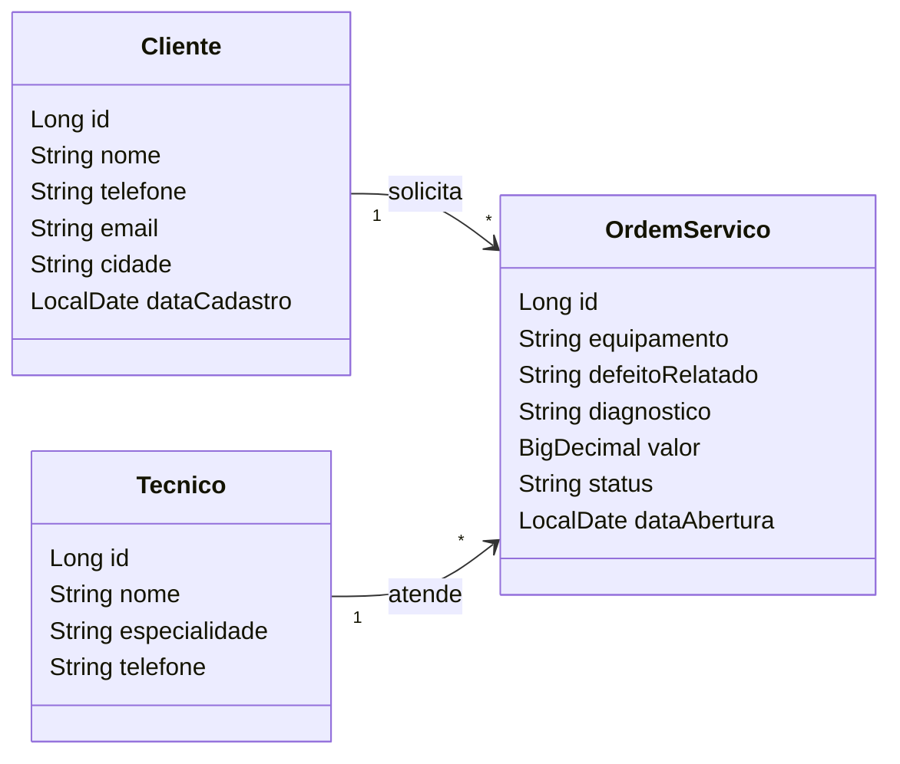

ORDEX

> Substitua o título acima pelo nome do seu sistema e preencha cada seção deste documento.
> Este README é o **documento de visão** do projeto (entrega **AVA 1**) e, ao longo do curso,
> também será o manual técnico de como executar o sistema.

| | |
|---|---|
| **Aluno(a)** | Enzo Renan Fontão |
| **Turma** |   TEC-N-01788/2026      |
| **Opção escolhida** | Ordens de Serviço  |
| **Versão atual** | 0.1.0 |

---

## 1. Visão geral

### 1.1 Problema
Empresas que realizam manutenção e assistência técnica precisam controlar os clientes, técnicos e ordens de serviço. Quando essas informações são registradas em papel, planilhas ou conversas no WhatsApp, podem ocorrer dificuldades para acompanhar os serviços, consultar informações e verificar o andamento dos atendimentos. O sistema Descomplica busca centralizar esses dados em uma aplicação web, facilitando o gerenciamento das ordens de serviço e o acompanhamento dos atendimentos.

### 1.2 Canvas do projeto

| Bloco | Resposta |
|---|---|
| **Usuários** (quem usa o sistema) | Administradores, operadores e técnicos responsáveis pelos serviços. |
| **Problema** (dor atual) | Dificuldade para organizar clientes, técnicos e serviços, além de acompanhar o andamento das ordens de serviço.|
| **Proposta de valor** (o que melhora com o sistema) | Centralizar as informações, facilitar consultas e permitir o acompanhamento organizado das ordens de serviço. |
| **Funcionalidades principais** | Cadastro e consulta de clientes, cadastro e consulta de técnicos, abertura de ordens de serviço, edição de informações, acompanhamento de status e gerenciamento dos atendimentos. |
| **Informações que o sistema guarda** | Dados dos clientes, dados dos técnicos, equipamentos, defeitos relatados, diagnósticos, valores, datas de abertura e situações das ordens de serviço. |
| **Indicadores** (o que o gestor quer acompanhar) | Quantidade de ordens abertas, em andamento e concluídas; quantidade de atendimentos por técnico; ordens pendentes e valores dos serviços. |
| **Restrições** (prazo, tecnologia, equipe) | Projeto individual · Java 21 · Spring Boot 4 · entrega v1.0 em 11/11 |

---

## 2. Requisitos

### 2.1 Requisitos funcionais (o que o sistema FAZ)

| ID | Requisito | Nível |
|---|---|---|
| RF01 | O sistema deve permitir cadastrar, listar, editar e excluir clientes. | Essencial |
| RF02 | O sistema deve permitir cadastrar, listar, editar e excluir técnicos. | Essencial |
| RF03 | O sistema deve permitir abrir, consultar, editar e excluir ordens de serviço. | Essencial |
| RF04 | O sistema deve permitir associar uma ordem de serviço a um cliente e a um técnico responsável. | Essencial | 
| RF05 | O sistema deve permitir registrar o equipamento, o defeito relatado, o diagnóstico e o valor do serviço. | Essencial |

### 2.2 Requisitos não funcionais (COMO o sistema deve ser)

| ID | Requisito |
|---|---|
| RNF01 | O sistema deve ser acessado pelo navegador, utilizando uma aplicação web. |
| RNF02 | O sistema deve exigir login e senha; as senhas devem ser armazenadas de forma segura, utilizando criptografia apropriada para senhas. |
| RNF03 | O sistema deve ser desenvolvido utilizando Java 21 e Spring Boot 4. |
| RNF04 | O sistema deve utilizar Spring Data JPA para persistência dos dados.|
| RNF05 | O sistema deve utilizar banco de dados H2 durante o desenvolvimento e permitir utilização do MySQL em produção. |

### 2.3 Regras de negócio (as REGRAS do negócio que o sistema precisa respeitar)

| ID | Regra |
|---|---|
| RN01 | Toda ordem de serviço deve estar vinculada a um cliente cadastrado. |
| RN02 | Toda ordem de serviço deve possuir um equipamento e um defeito relatado. |
| RN03 | Toda ordem de serviço deve possuir uma data de abertura. |
| RN04 | O valor de uma ordem de serviço não pode ser negativo. |
| RN05 | Uma ordem de serviço deve possuir uma situação válida: Aberta, Em andamento, Concluída ou Cancelada. |

---

## 3. Histórias de usuário

Formato: **Como** *[papel]*, **quero** *[ação]*, **para** *[benefício]*.

**HU01 —** 
Como administrador, quero cadastrar, consultar, editar e excluir clientes, para manter os dados dos clientes organizados no sistema.

-Critério de aceite: O sistema deve permitir cadastrar um cliente com nome e demais informações disponíveis.

-Critério de aceite: O sistema deve permitir consultar os clientes cadastrados.

-Critério de aceite: O sistema deve permitir editar e excluir clientes, respeitando os vínculos com ordens de serviço.

**HU02 —** Cadastro de técnicos
Como administrador, quero cadastrar e consultar técnicos, para organizar os profissionais responsáveis pelos atendimentos.

Critério de aceite: O sistema deve permitir cadastrar técnicos com nome, especialidade e telefone.

Critério de aceite: O sistema deve permitir consultar os técnicos cadastrados.

Critério de aceite: O sistema deve permitir editar e excluir técnicos, respeitando os vínculos com ordens de serviço.
---

## 4. Modelo de dados



---

## 5. Como executar

### No GitHub Codespaces (recomendado)
1. No repositório, clique em **Code → Codespaces → Create codespace on main** (ou abra o Codespace existente).
2. Aguarde a preparação do ambiente.
3. No terminal, execute:
   ```bash
   mvn spring-boot:run
   ```
4. Quando aparecer o aviso da porta **8080**, clique em **Abrir no navegador**.

### No computador (ferramentas instaladas)
Requisitos: JDK 21 e uma IDE (IntelliJ IDEA ou VS Code com o *Extension Pack for Java*).
Abra o projeto na IDE e execute a classe `SistemaApplication`. Acesse `http://localhost:8080`.

### Acesso
| Usuário | Senha | Perfil |
|---|---|---|
| admin | admin123 | Administrador |
| operador | operador123 | Operador |

*(o login passa a ser exigido a partir do Encontro 7)*

---

## 6. Tecnologias
Java 21 · Spring Boot 4 · Spring MVC · Thymeleaf · Bootstrap 5 · Spring Data JPA · H2 (desenvolvimento) · MySQL (produção) · Spring Security · Git/GitHub

## 7. Uso de inteligência artificial
<Usei Inteligência Artificial para consertar certos bugs dos funcionamentos do site, exemplo são funcionar cadastro dos usúario de teste>

## 8. Histórico de versões
| Versão | Data | Descrição |
|---|---|---|
| 0.1.0 | | Projeto inicial criado a partir do repositório modelo |

## Usuários de teste

| Usuário | Senha | Perfil | O que pode fazer |
|---|---|---|---|
| admin | admin123 | Administrador | Tudo |
| operador | operador123 | Operador | Consulta clientes e técnicos, abre ordens de serviço e muda a situação delas |
